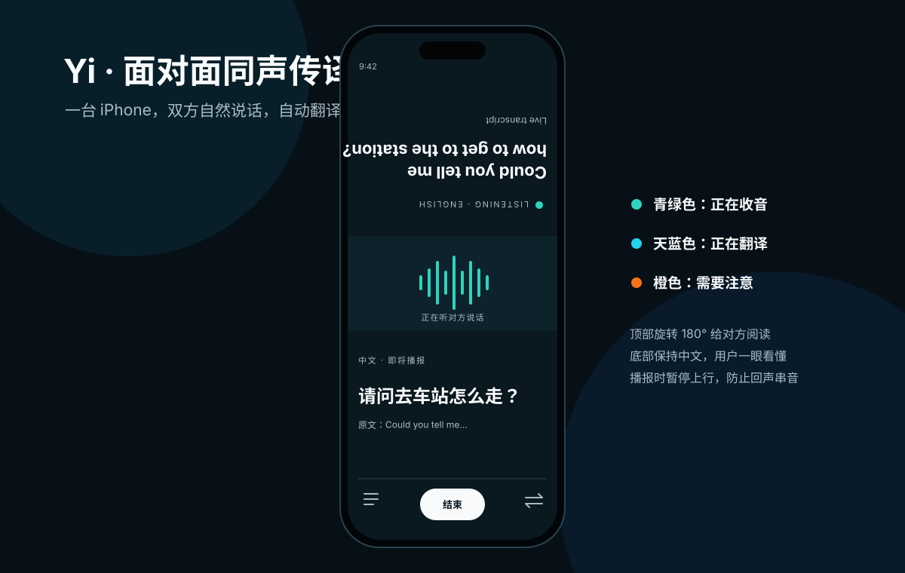

# Yi

Yi 是一款面向 iPhone 的面对面双向同声传译 App 方案。把一台手机放在两个人中间，即可在中文与英语、日语或韩语之间自动轮流听、译、说。

## 当前仓库内容

- [产品与技术设计](docs/superpowers/specs/2026-11-02-yi-ios-simultaneous-interpretation-design.md)
- [iOS 实施计划](docs/superpowers/plans/2026-11-02-yi-ios-implementation.md)
- [实时翻译网关实施计划](docs/superpowers/plans/2026-11-02-yi-gateway-implementation.md)
- [可交互 UI 原型](docs/ui/yi-prototype.html)
- [UI 原型说明](docs/ui/README.md)
- [设计系统](design-system/yi/MASTER.md)

## 首版技术方向

- iPhone：SwiftUI + AVAudioEngine + URLSessionWebSocketTask。
- 服务端：Go WebSocket 网关，负责密钥保护、火山引擎协议转换和限流。
- 英语/日语：优先使用火山引擎 AST 语音到语音。
- 韩语：AST 语音到文本，再接韩语 TTS。
- 对话：半双工自动轮流，播报时暂停上传麦克风音频，避免回声重复翻译。

> 当前提交是方案与 UI 原型，不包含可编译的 iOS App 或已部署网关。

