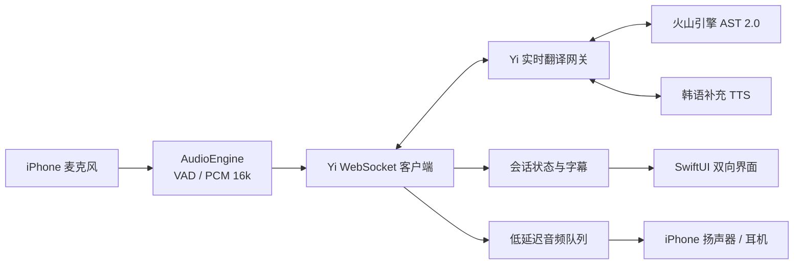

# Yi iPhone 面对面同声传译 App 设计方案

日期：2026-11-02  
状态：已确定，可进入实施规划  
目标平台：iPhone（iOS 17 及以上）

## 1. 产品目标

Yi 是一款面对面双向语音翻译 App。用户把一台 iPhone 放在两人中间，选择英语、日语或韩语后开始对话：

- 对方说外语，App 显示原文和中文译文，并用中文播报。
- 用户说中文，App 显示中文原文和外语译文，并用目标外语播报。
- 正常对话不需要按住按钮或手动切换方向。
- 双方都能从各自朝向直接看到当前状态和译文。

首版优先保证“稳定、听得懂、不会串音”，不追求多人会议、重叠说话或离线翻译。

## 2. 已确认的官方接口能力与约束

参考：[火山引擎同声传译 2.0 API 接入文档](https://docs.volcengine.com/docs/doubao-voice/simultaneous-interpretation2-0-api-access-documentation?lang=zh)

- 服务端点：`wss://openspeech.bytedance.com/api/v4/ast/v2/translate`
- 协议：WebSocket + Protobuf。
- 推荐鉴权：`X-Api-Key` 与固定资源 ID `volc.service_type.10053`。
- 输入音频：16 kHz、16 bit、单声道 WAV/PCM，建议每 80 ms 发送一包。
- 必须收到 `SessionStarted` 后才能发送音频包。
- 同一会话不能切换语言或 `s2s` / `s2t` 模式；切换时必须重建会话。
- S2S 支持中文、英语、日语等 8 种语言，但不支持韩语。
- S2T 支持韩语。因此韩语方向需要使用 AST 输出文本，再调用 TTS 合成目标语音。
- 服务端会返回原文、译文、TTS 音频、计费信息、静音事件和用于排错的 Log ID。

## 3. 方案比较

### 方案 A：iPhone 直接连接火山引擎

开发最快，网络路径最短，但 API Key 必须进入 App 包，容易被提取和滥用；客户端还要直接处理 Protobuf、重连和供应商协议。仅适合一次性内部演示，不适合发布。

### 方案 B：iPhone + Yi 网关 + 火山引擎（采用）

iPhone 只连接 Yi 网关，网关保存 API Key、管理两种翻译方向的会话、转换 Protobuf，并把统一事件返回给客户端。多一跳带来少量延迟，但安全性、可维护性、限流和韩语 TTS 组合能力显著更好。

### 方案 C：全部使用端侧模型

隐私和离线能力最好，但中文、英、日、韩四语的实时识别、翻译、语音合成和模型体积远超首版范围，质量与功耗也难以在短期内达到云服务水平。

## 4. 总体架构



### iPhone 客户端

- SwiftUI：界面和状态呈现。
- AVAudioEngine：采集麦克风、转成 16 kHz 单声道 PCM、分割为约 80 ms 音频帧。
- AVAudioSession：使用 `.playAndRecord` 与语音处理模式，控制回声和扬声器路由。
- WebSocket 客户端：只使用 Yi 自定义协议，不持有火山引擎密钥。
- TranslationStateMachine：统一管理准备、监听、翻译、播报、恢复、错误状态。
- AudioPlaybackQueue：顺序播放服务端返回的音频，播报时暂停上行，避免回声被再次翻译。

### Yi 实时翻译网关

- 首选 Go 实现，便于处理长连接、二进制帧和并发会话。
- 保存火山引擎 API Key，并负责供应商 WebSocket / Protobuf 协议。
- 为每次对话维护两个逻辑方向：`外语 → 中文` 与 `中文 → 外语`。
- 统一输出客户端事件：连接状态、原文增量、译文增量、音频块、用量、错误。
- 韩语路径：AST S2T 取得译文，再调用支持韩语的 TTS；英语和日语优先使用 AST S2S。
- 实施安装级令牌、并发限制、速率限制和会话最长时间，防止密钥与额度滥用。

## 5. 自动对话策略

首版采用半双工自动轮流状态机。它比同时收音和播报更稳定，也更适合一台手机面对面使用。

1. 开始时默认监听外语方向。
2. VAD 检测到说话后开始上传音频，静音达到句尾阈值后结束本轮。
3. 服务端返回译文和音频，App 先显示译文，再播放。
4. 播放完成后自动切换为中文方向，等待用户回答。
5. 用户回答并完成外语播报后，自动切回外语方向。
6. 若同一方连续说话，用户可轻点中央的“交换方向”按钮立即纠正；该按钮是异常兜底，不是正常操作步骤。

“自动判断谁在说话”在首版中由对话轮次、VAD 和当前方向共同完成，不承诺在两个人同时说话时分离说话人。这样可以显著降低误译、啸叫和 TTS 回录。

## 6. UI 设计

### 视觉原则

- 一台手机、两个朝向：上半屏旋转 180° 给对方看，下半屏给用户看。
- 状态优先于装饰：始终明确显示“正在听对方”“正在翻译”“正在为对方播报”。
- 青绿色代表正在收音或连接正常；白色代表译文；灰蓝色代表原文和辅助信息；错误使用克制的珊瑚红。
- 深色背景减少陌生人面对面使用时的视觉干扰，也适合旅行、餐厅和车站环境。
- 所有关键文字支持 Dynamic Type；状态不只依赖颜色表达。

### 主界面布局

- 顶部对方区：目标外语、对方原文或准备播报给对方的译文，整体旋转 180°。
- 中央状态区：动态声波或播放图标、当前动作说明、轻量方向纠错入口。
- 底部用户区：中文原文/译文和简短的次要字幕。
- 底栏：会话记录、结束会话、语言设置；正常对话中不显示复杂菜单。

### 核心状态

1. **就绪**：显示语言对和“开始对话”。
2. **监听**：声波动画、当前输入语言、实时原文。
3. **翻译**：冻结本句原文，逐步呈现译文。
4. **播报**：显示播放状态，暂停麦克风上行。
5. **静音等待**：保留最近一句，提示轮到哪一方。
6. **可恢复错误**：网络中断时自动重连，并保留已有字幕。
7. **不可恢复错误**：权限、额度或服务配置错误，给出明确下一步。

永久可浏览的 UI 原型位于 `docs/ui/yi-prototype.html`。

## 7. 首版范围

### 包含

- 中文与英语、日语、韩语的面对面双向对话。
- 实时原文、译文和语音播报。
- 自动交替对话、方向纠错、开始/结束。
- 会话内字幕记录；默认只存在本机内存，结束后可由用户选择是否保存。
- 扬声器、听筒和蓝牙耳机路由。
- 网络恢复、接口错误、麦克风权限和额度错误提示。
- 基础使用量与延迟监控，不记录原始音频。

### 不包含

- 多人会议、重叠说话分离和远程通话。
- 后台持续录音、锁屏翻译和电话通话接管。
- 离线翻译、自定义声音克隆、账号体系和跨设备同步。
- 首版 App Store 订阅与支付。

## 8. 客户端与网关协议

客户端连接：`wss://<yi-gateway>/v1/conversations`

客户端控制消息使用 JSON，音频使用二进制帧：

```json
{
  "type": "start",
  "conversationId": "uuid",
  "nativeLanguage": "zh",
  "foreignLanguage": "ja",
  "direction": "foreign_to_native",
  "audio": {
    "encoding": "pcm_s16le",
    "sampleRate": 16000,
    "channels": 1
  }
}
```

网关返回统一事件：

```json
{
  "type": "translation.final",
  "conversationId": "uuid",
  "turnId": "uuid",
  "direction": "foreign_to_native",
  "sourceText": "Could you help me?",
  "translatedText": "你能帮我吗？",
  "providerLogId": "redacted-log-id"
}
```

音频块使用带简短头部的二进制帧，避免把音频转成 Base64。客户端收到 `playback.started` 后停止上传麦克风音频，收到 `playback.finished` 后进入下一轮监听。

## 9. 错误处理

- 网络瞬断：指数退避重连，最多自动尝试 3 次；屏幕保留已有字幕。
- 供应商忙或 5xx：单轮可重试一次，随后展示“服务暂时繁忙”。
- 请求参数/音频格式错误：停止本轮并记录 provider Log ID，避免无限重试。
- 麦克风权限拒绝：进入权限说明页，并提供跳转系统设置入口。
- 无有效语音：不切换方向，继续当前监听状态。
- 播放失败：仍展示译文，并允许重新播放本句。
- 韩语 TTS 失败：降级为只显示韩语文本，不丢失翻译结果。

## 10. 隐私与安全

- 火山引擎 API Key 只存在于网关环境变量或密钥服务。
- 客户端使用短期安装令牌连接网关，不包含云服务凭据。
- 默认不持久化原始音频；服务日志只记录时间、语言、耗时、错误码和脱敏后的会话 ID。
- 用户明确选择保存时才在本机保存文本记录。
- 隐私说明明确告知语音会发送到云端进行识别、翻译和合成。
- 对日志、会话并发和单日额度设置硬限制。

## 11. 测试与验收

### 单元测试

- 对话状态机的所有合法/非法状态转换。
- PCM 格式、采样率、帧大小与重采样。
- 网关协议编码、供应商事件映射和错误映射。
- 英/日 S2S 与韩语 S2T + TTS 路由选择。

### 集成测试

- 模拟 AST WebSocket，覆盖增量字幕、最终字幕、TTS、静音、失败和重连。
- 真机测试扬声器回声抑制、蓝牙切换、来电/闹钟造成的 AudioSession 中断。
- 弱网、高延迟和断网恢复。

### 首版验收标准

- 开始会话后 2 秒内进入可监听状态。
- 正常网络下，句尾到首段译音播放的目标延迟不超过 2.5 秒。
- 连续完成 20 轮中英、中日和中韩对话，不需正常手动切换方向。
- TTS 播放不会被作为新输入再次翻译。
- App 包和客户端网络日志中不存在火山引擎 API Key。
- 服务异常时界面不崩溃、不丢失已完成字幕，并提供可执行的恢复提示。

## 12. 实施边界

当前仓库可在 Windows 上完成产品文档、协议、网关和跨平台测试；真正的 iOS 工程编译、签名、真机音频验证和 App Store 打包需要 macOS、Xcode 及 Apple Developer 账号。
